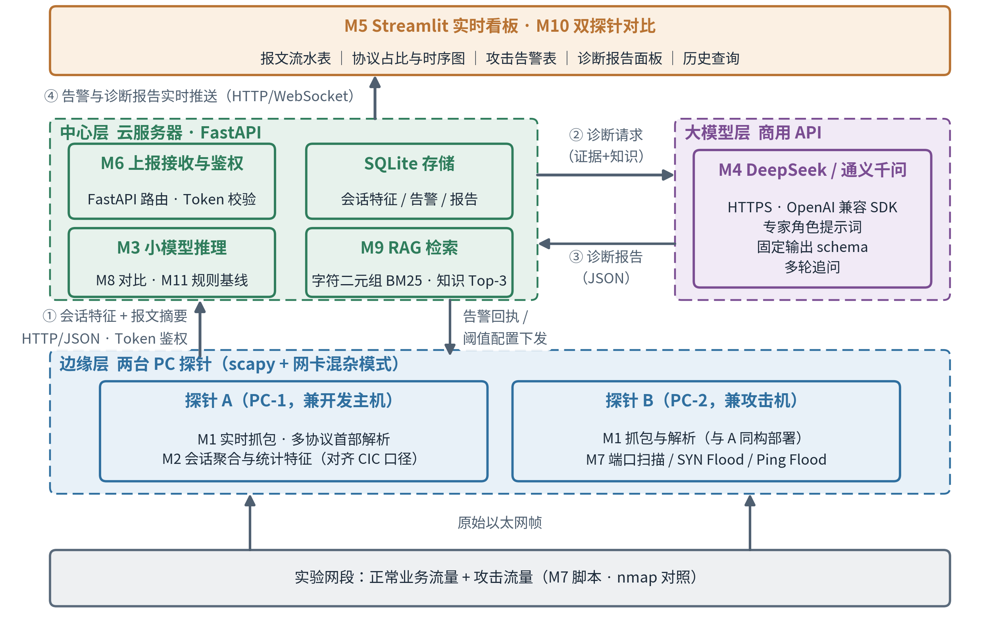
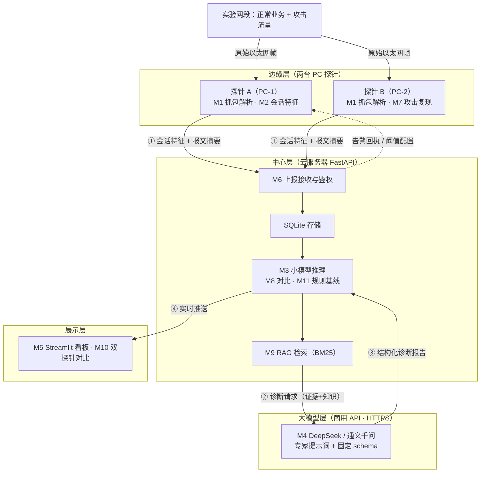
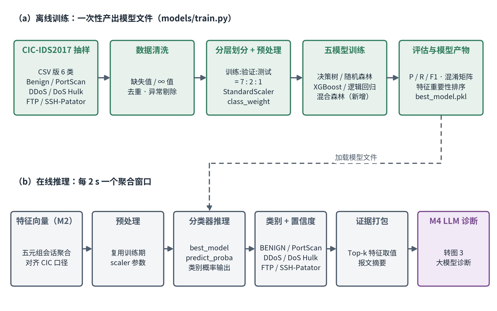
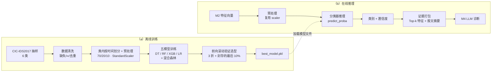
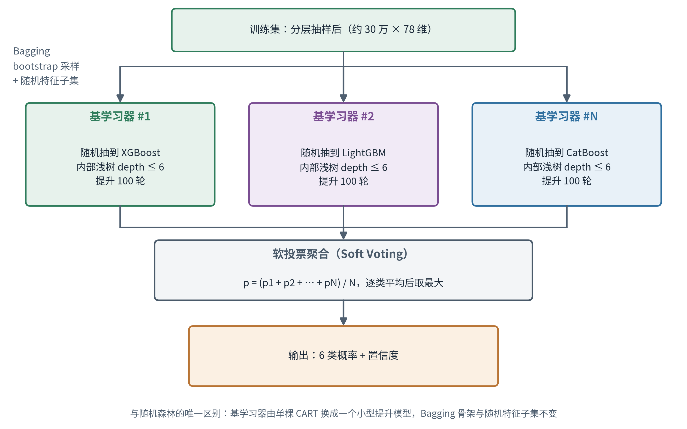
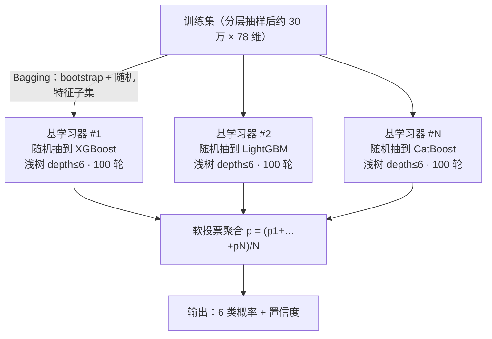
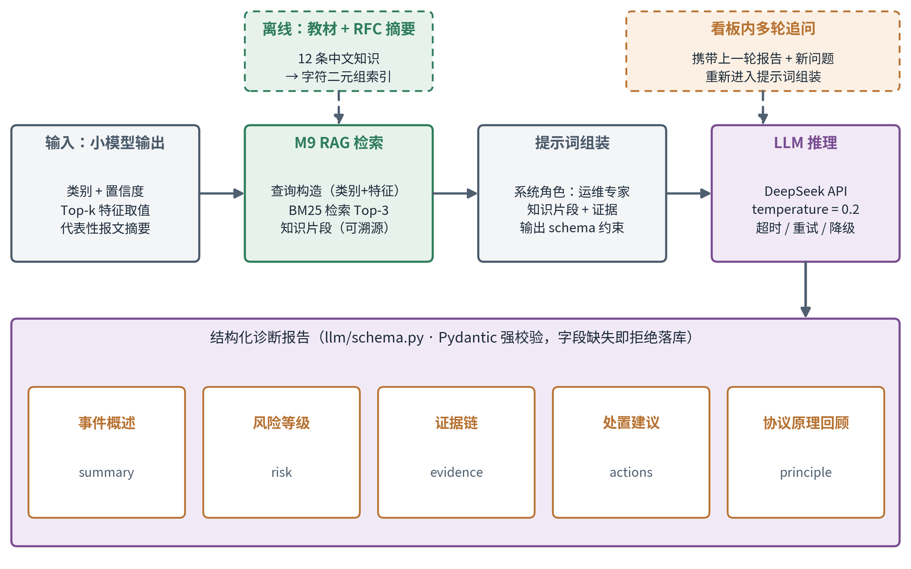
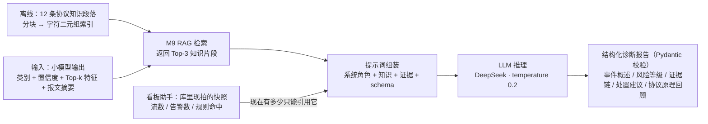

# 系统设计图

三张图的 PNG 由 `docs/make_figures.py` 用 matplotlib 生成（300 dpi，中文用 Noto Sans CJK），
放进 Word 报告时按版心宽 15.2 cm 插入即可。下面同时给出 Mermaid 源，方便在编辑器里预览与改结构。

---

## 图 1 系统总体架构图

**建议图注**：图 3-2 系统总体架构（云边协同，共四层：边缘层负责"看见"网络，中心层负责"判断"异常，
大模型层负责"解释"结果，展示层负责交付给人；①—④ 为单次检测的主要数据流）

---

## 图 2 小模型结构图

**建议图注**：图 4-3 攻击检测小模型结构（(a) 离线训练一次性产出模型文件；(b) 在线推理每 2 s 一个聚合窗口，
复用训练期的 scaler 与特征口径，保证训练与推理一致）

---

## 图 2b 混合森林内部结构（第五个模型）

**建议图注**：图 4-4 混合森林内部结构（外层沿用随机森林的 Bagging 骨架，bootstrap 采样与随机特征子集不变；
内层基学习器从 XGBoost / LightGBM / CatBoost 中随机抽取，训练成小型提升模型后软投票聚合）

### 这个模型解决什么问题

随机森林和 GBDT 是两种互补的集成范式：

| | 随机森林（Bagging） | GBDT（Boosting） |
|---|---|---|
| 基学习器关系 | 并行、相互独立 | 串行、后一棵拟合前一棵的残差 |
| 主要降低 | **方差** | **偏差** |
| 基学习器深度 | 深树（充分拟合） | 浅树（3–8 层） |
| 对噪声/离群点 | 较鲁棒 | 较敏感 |

混合森林的思路是**两层都管**：外层用 Bagging 做样本与特征扰动来压方差，内层用提升来压偏差。
代价是训练成本约为单个提升模型的 N 倍。

### 实现上的三个要点

1. **基学习器内部必须是浅树**（`base_depth = 6`），不能用 24 层。GBDT 的表达能力来自"很多棵浅树叠加"，
   一棵 24 层的树几乎就能把训练集拟合完，后续提升轮次没有残差可学，等于退化成"换了个库跑单棵 CART"。
2. **三个库的概率尺度要统一**。XGBoost 与 CatBoost 多分类输出经 softmax，LightGBM 直接给归一化概率，
   软投票前统一走各自的 `predict_proba`，不一致时做校准。
3. **训练成本要按"树"算，不能按"轮"算，而且三个库的口径不一样**（实测确认）：
   - XGBoost / LightGBM 多分类：每轮**每类各长一棵树** → 100 轮 × 6 类 = 600 棵/基学习器
   - CatBoost `MultiClass`：每轮只长**一棵树**，叶子是 6 维向量 → 100 轮 = 100 棵/基学习器

   混合森林 24 个基学习器（三个库各 8 个）共 **8×600 + 8×600 + 8×100 = 10400 棵树**；
   同样口径下 XGBoost 单独一个模型 300 轮 × 6 类 = 1800 棵、CatBoost 单独 300 棵。
   30 万样本上预计几分钟到十几分钟，如果超时先降 `base_rounds`（100 → 60），再降 `n_estimators`。
   **报告里报成本要报到树数**，只写"100 轮"会让读者把量级估小 6 倍。
   `models/hybrid_forest.py:count_trees()` 直接从拟合好的模型里数，成本表别手算。

### DART 消融实验（残差相关，单列一节）

梯度提升的每一轮都是"拟合上一轮的负梯度残差"，这是原理不是创新点。真正的可做变体是 **DART**
（Dropout meets Multiple Additive Regression Trees）：每轮随机丢弃一部分已建好的树，抑制提升器
对噪声样本的过专门化，最后再对所有树归一化。

消融设计要点（只改一个变量，否则结论不可信）：

- **固定基学习器为 LightGBM**，不放进混合森林里做——混合森林同时随机抽三种库，
  再叠 DART 就把"库种类"和"丢弃策略"两个变量搅在一起了。
- 两组对比：`lgbm_plain`（boosting_type=gbdt）vs `lgbm_dart`（boosting_type=dart, drop_rate=0.10）。
- **CatBoost 没有 DART 实现**，不能当消融载体；XGBoost 有但慢，作为备选。
- 代价：DART 的树要重新归一化，**不支持早停**，训练明显变慢。预期在 30 万样本上收益很小甚至为负，
  报告里要如实写，别为了凑创新点硬说提升。

配置见 `config.yaml` 的 `model.dart_ablation`。

### 实测结果（2026-10-27，25 万行真实样本）

**结论一：随机特征子集在这里是负优化，必须单独交代。**

| 混合森林变体 | reliable macro-F1 | 训练 |
|---|---|---|
| `max_features="sqrt"`（每成员 8/78 维） | 0.9899 | 4.3s |
| `max_features=1.0`（每成员 78 维） | **0.9986** | 8.7s |

差 0.0087，比"三个库混不混"重要得多。原因是随机森林的 `max_features` 是为**高方差的深树**
设计的：每棵树看不到全部特征，树与树之间去相关，平均后方差下降。而提升器是**低方差的浅树串行加和**，
每轮本来就在拟合前一轮的残差，随机砍掉 90% 的特征等于让每轮残差都学偏 —— 它缺的不是方差而是信息。
**这条要写进报告**，它比"混合森林没用"有价值得多，说明我们区分开了 Bagging 和 Boosting 各自需要什么。

**结论二：随机划分下的 0.999 是划分泄漏，不是模型能力。**

随机划分下决策树 / 随机森林 / XGBoost / 混合森林全部落在 0.999 附近，极差 < 0.001，
名次由噪声决定（验证集里 Heartbleed 只有 1–2 个样本，判对判错直接摆动 1/6 的总分，
实测能把随机森林从第一拉到第五）。

原因在数据集本身：CIC-IDS2017 的随机划分会把同一天的近似重复流同时分到训练和测试
（我们抽的 25 万行里 9.7% 是完全重复行，去掉后仍剩大量只差几个字段的短流）。
证据是 **XGBoost 与一棵决策树只差 0.0002**——如果 0.999 反映了模型对攻击行为的建模能力，
多出来的 1799 棵树不可能一点用都没有。

所以选型改用**剔除稀有类后的 macro-F1**（`macro_f1_reliable`），稀有类单列不参与选择。

### 换成按时间划分之后（2026-10-28）

口径（`--split temporal`）：**每个类在样本内部按时间戳排序**，最早的 70% 训练、接下来 20% 验证、
最后 10% 测试。不做按整天留出——原因见"结论二之五"。

| 模型 | 验证集 | 最后 10% |
|---|---|---|
| decision_tree | 0.9971 | 0.9637 |
| random_forest | 0.9975 | 0.9500 |
| xgboost | **0.9975** | **0.9743** |
| logistic | 0.9216 | 0.9630 |

（训练 160,349 / 验证 45,814 / 测试 22,907；四模型即 `models/train.py --split temporal
--out models/artifacts/tsv`，可复现。）

**这张表最重要的不是"掉了 3 个点"，而是"用验证集选型等于抛硬币"。** random_forest 与 xgboost
在验证集上完全并列（0.9975 vs 0.9975），在最后 10% 上却差 0.0243；按验证集选会选中
random_forest，而测试集说的是 xgboost。单段验证集紧贴训练段的尾部，同一段流量里的近似重复还在，
它测不出"再往后滑一段会不会失手"。

**结论二之三：前向滚动验证（expanding window）是这个数据集上唯一站得住的选型依据。**

把前 90% 的开发段按类内时间再切 5 块，第 k 折用 blocks[0:k] 训练、blocks[k] 验证，取 k=2,3,4；
最后 10% 全程封存，只在最后报一次（`--split temporal-cv`，默认选型口径）。

| 模型 | 折 1 | 折 2 | 折 3 | 均值 ± 标准差 | 最后 10% |
|---|---|---|---|---|---|
| decision_tree | 0.9914 | 0.9454 | 0.9978 | 0.9782 ± 0.0234 | 0.9674 |
| random_forest | 0.9987 | 0.9446 | 0.9984 | 0.9806 ± 0.0255 | 0.9562 |
| xgboost | 0.9993 | 0.9464 | 0.9994 | **0.9817 ± 0.0249** | **0.9719** |
| logistic | 0.9759 | 0.9334 | 0.9166 | 0.9419 ± 0.0250 | 0.9646 |
| hybrid_forest | 0.9971 | 0.9431 | 0.9909 | 0.9770 ± 0.0241 | 0.9362 |

两条读数：

1. **退化不是"越往后越差"的单调漂移。** 折 1 与折 3 都在 0.99 以上，难的是折 2（0.94 附近）。
   难样本卡在中间，说明数据里有一段时间的流量形态与其它时段不同，而不是分布持续右移。
   报告里不要写成"时间越久越不准"——那是编出来的解释，数据不支持。
2. **标准差（0.024）比模型之间的差距（0.0011）大一个量级，所以"五选一"要如实写成并列。**
   滚动均值只能把 logistic 拉出来（它确实差一档），区分不出前四名。最终仍按均值选 xgboost
   上线，理由是它每一折都不垫底且推理最快，不是因为它"更强"。

**结论二之四：退化集中在 DoS Hulk 一类，不是全面掉点。**

最后 10% 上的分类召回（同一批模型，同一份测试集）：

| 模型 | BENIGN | DDoS | DoS Hulk | Patator | PortScan |
|---|---|---|---|---|---|
| decision_tree | 0.977 | 0.996 | 0.899 | 0.964 | 0.991 |
| random_forest | 0.975 | 0.993 | 0.815 | 0.974 | 0.990 |
| xgboost | 0.969 | 0.996 | 0.913 | 0.997 | 0.998 |
| logistic | 0.961 | 0.993 | 0.972 | 0.992 | 0.994 |
| hybrid_forest | 0.998 | 0.993 | **0.629** | 0.945 | 0.993 |

同样这几个模型在验证段上 DoS Hulk 召回都在 0.99 以上。掉下来的只有这一类，其余五类基本持平。
含义是：**一句"准确率 0.97"会把一类攻击的显著退化盖住**，报告必须按类报召回。
混合森林掉到 0.629 最狠，我们**没有单独做消融定位成因**（成员间偏差方向不一致时软投票未必抵消极值），
先如实记为观测事实，不写成解释。

**结论二之五：按天留出在 6 类模型上不可用，那是开集问题，不是泛化问题。**

CIC-IDS2017 的每一类攻击只出现在某一天的抓包文件里（DDoS / PortScan 在星期五，
DoS Hulk 在星期三……）。所以"周一到周四训练、周五测试"等于把 DDoS 与 PortScan 当成
训练时根本没出现过的类别塞给模型。`tools/cross_day_eval.py` 实测了两种口径：

| 口径 | 结果 |
|---|---|
| A 闭集（只用周一到周四出现过的 4 类训练） | BENIGN 告警率 0.01%；DDoS 60.05%（24,021 条全被判成 DoS Hulk）；PortScan 0.47%（只有 153 条被标为非 BENIGN） |
| B 二分类（BENIGN vs 攻击） | 准确率 0.4982；攻击召回 0.3506、攻击精确率 0.9999；分天看 DDoS 召回 63.3%、PortScan 0.41% |

精确率 0.9999 配召回 0.35，说明模型**只对自己见过的形状开口**：DDoS 与 DoS Hulk 形态相近所以能认，
PortScan 几乎全程沉默（32,655 条里只有 134 条被判成攻击）。

所以要修正原来的说法：**按天划分测出来的主要是开集失败，不是泛化差距。** 谈泛化用类内按时间的
前向滚动验证；谈开集就显式把它写成一条结论。这也正是在线路径必须保留大模型层的实测依据——
小模型遇到没见过的形状时**既不报警也不报错**，只有把证据交给大模型才能说清"这条流是什么"。

### 在线路径实测：提取器与数据集的三处口径错配（2026-10-28）

把 M2 的特征提取器接到真实抓包上回头核对，发现三处"列名一样、算法不一样"的地方。
这三处都不会报错，只会让线上向量悄悄落到训练分布之外，所以逐条记下来。

| 列 | 数据集口径 | 改前我们的口径 | 判据 |
|---|---|---|---|
| `Fwd/Bwd Packet Length *`、`Packet Length Mean/Std/Max/Min`、`Average Packet Size`、`Total Length of Fwd/Bwd Packets`、`Subflow Fwd/Bwd Bytes`、`Flow Bytes/s` | **L4 载荷字节**（不含 IP/TCP 头） | IP 总长度 | 数据集里单包流的这些列取值只有 0 / 2 / 6；改前我们把一个 40 字节的纯 SYN 记成 40 |
| 八个 `* Flag Count` 与 `Fwd/Bwd PSH/URG Flags` | **0/1 表示"是否出现过"**，不是次数 | 出现次数 | 全表 `RST/ECE/CWE` 恒为 0、`PSH Flag Count` 只有 {0,1}；改前 200 包洪流给出 `Fwd PSH Flags=200`，相对全表 z≈1006 |
| 流的聚合形态 | 长流慢速 | 短流突发 | 见下表 |

前两处已按数据集口径对齐（`probe/features.py`），并各有一条回归测试钉住：
`test_packet_length_columns_count_l4_payload_only`、`test_flag_columns_are_indicators_not_counts`。

第三处不是 bug，是数据集的采集方式：

| | 数据集里的 DoS Hulk（中位行） | 我们构造的同名流量 |
|---|---|---|
| Flow Duration | 84.9 s | 0.10 s |
| 前向包数 | 6 | 200 |
| Flow Packets/s | 0.16 | 2010 |

按数据集形态造一条流（6 个前向小包 + 6 个后向 1656 字节包、跨 85 s、PSH 置位），
其余各列都能对上，判定仍是 **BENIGN 0.9999**。而数据集自己的行没有问题——
时间留出集上 PortScan 召回 0.998、DoS Hulk 0.913（见结论二之四），前 300 条 PortScan
抽样行 300/300 判对。

结论：**模型学到的是"这份数据集"的判别边界，不是"这类攻击"的判别边界。** 于是线上路径要这样分工：

- 小模型负责在**已知形态**里给出类别与置信度，用于方法验证与看板演示；
- 线上真实流量要靠 **M11 规则引擎**兜底（同源短窗口内大量不同目的端口、单目的端口的半连接激增），
  这类判据不依赖采集口径；
- 遇到没见过的形态，小模型**既不报警也不报错**（与跨天实验同一条结论），
  所以大模型层不是"锦上添花"，是这条链路上唯一能解释陌生流量的部件。

两条环境记录（都实测过）：`--max-age` 默认 30 s 会把长流截断，与数据集 120 s 空闲超时不一致，
演示长流时要调大；本机 `ALL_PROXY=socks://…` 会让 httpx 在**构造 Client 时**就抛 `ValueError`，
探针连局域网中心改 `trust_env=False`，大模型客户端捕获该异常后降级为模板报告（不再拖垮服务）。

**结论三：混合森林不会显著超过调好的单个 XGBoost/CatBoost——实测反而更低。**
提升模型本身方差已经很低，再套一层并行平均，能压的方差有限，而训练成本翻几十倍
（前向滚动口径：652.3s / 10400 棵 vs 12.7s / 1800 棵，约 51 倍）。
滚动均值 0.9770 低于 xgboost 的 0.9817，最后 10% 上 0.9362 是五个模型里最低的。

它的价值在**设计论证**而不是指标：说明我们理解 Bagging 与 Boosting 各自降低的是偏差还是方差、
以及二者嵌套后为什么在"高方差高偏差并存"的数据上才划算。报告里要如实给出这个结论，
不要为了"创新点"硬说它最好——答辩老师最容易追问的就是这一句。

### M11 规则基线：阈值规则能做到什么、做不到什么（2026-10-28）

规则层有两组阈值，用途不同，不能混着谈：

| 组 | 规则 | 阈值从哪来 |
|---|---|---|
| 单流规则 | `portscan_short` `ddos_burst` `hulk_long` `patator_short` `heartbleed_single` | 训练段（前 70%）各类分位数 |
| 现场行为规则 | `port_scan` `syn_flood` `brute_force` `flood_single` `scan_single` | 窗口/速率这类行为量 |

对照组用同一段类内时间留出测试集（22 907 行）：

| 类别 | 规则 精确率 | 规则 召回率 | 规则 F1 | 小模型 F1 |
|---|---|---|---|---|
| BENIGN | 0.633 | 0.607 | 0.620 | 0.979 |
| DDoS | 0.919 | 0.471 | 0.623 | 0.955 |
| DoS Hulk | 0.704 | 0.256 | 0.376 | 0.954 |
| Patator | 0.500 | 0.905 | 0.644 | 0.998 |
| PortScan | 0.468 | 0.989 | 0.635 | 0.973 |
| **macro-F1** | | | **0.5795** | **0.9719** |

两列都来自同一段测试集（22 907 行、同一 `--split temporal-cv` 的最后 10%）、
同一 macro 口径（剔除样本数 < 30 的类，即 Heartbleed）。
小模型一列取 `models/artifacts/comparison.json` 里 xgboost 的 `test.per_class`。

这个 0.5795 要读对两件事：

1. 它只是**单流规则**的成绩——每次判定只看得见一行特征。端口扫描真正依靠的是"同一源在窗口内
   探了多少个目的端口"，而这条信息在 CSV 里根本不存在（78 列特征里没有源/目的 IP，也没有时间戳）。
   线上规则引擎用的是窗口判据，能力不止这个数。**所以不能拿 0.5795 去证明"规则无用"。**
2. 规则在**小模型失效的那种形态**上确实工作。两条实测：25 条单包 SYN 探测流走完整链路，
   小模型 25 条全判 BENIGN，规则层出 1 条 PortScan 告警；把数据集里 3 条 PortScan + 3 条
   DoS Hulk 行喂进去，小模型出 6 条告警且每条都带六类概率，规则同时给其中 4 条补了印证命中。

两条实现约定，答辩时可能被问到：

- **去重按域，不按规则**。一次 200 端口的扫描会同时命中 `port_scan`、`portscan_short`、
  `scan_single` 三条规则；若每条各报一次，看板就被刷满，"这是一次扫描"反而看不出来。
  所以扫描类共用一个按源 IP 的去重域，洪泛类按目的 `IP:端口`，每次只报一条、60 秒冷却。
- **规则不输出置信度**。告警表的 `confidence` 列在 `source='rule'` 时存的是"超出阈值多少倍"，
  不是概率，看板和报告都按这个措辞写（"超出阈值 5.00 倍"），不与小模型的 0.996 并列比较。

---

## 图 3 大模型诊断管线

**建议图注**：图 4-5 大模型诊断管线（RAG 先检索教材与 RFC 片段再组提示词，输出由 Pydantic schema 强校验，
字段缺失即拒绝落库，避免模型自由发挥）

---

## 设计说明（写进报告 3.x / 4.x 的要点）

### 为什么分三层而不是"一个大模型全包"

小模型在结构化表格特征上又准又快（CPU 毫秒级），适合 2 s 一个窗口的实时判断；
大模型擅长解释与组织自然语言，但直接读包既慢又贵、还会编造。
因此把"判断"和"解释"拆开：小模型出类别与置信度，大模型只在这个结论之上做语义化与处置建议。

### 为什么协议类型不用机器学习

UDP / TCP / ICMP 等协议类型由以太网类型字段与 IP 首部 protocol 字段直接确定，**是确定性事实**，
应当用规则解析。机器学习只用在"载荷加密、规则难穷尽"的统计行为层面（端口扫描、洪水、暴力破解）。
这条要写进报告 4.3 节，先发制人回答"为什么不直接读协议号"。

### 训练与推理必须同一把尺子

`feature_schema.json` 记录特征列名与顺序，`scaler` 参数随模型一起持久化；
探针侧聚合窗口、特征口径与训练集对齐（对齐 CIC-IDS2017 口径）。任一侧改动都要重训并重测，
否则线上分数会与离线指标脱节。

### 为什么不上深度学习（写进报告第 6 章"展望"，答辩口径）

1. **特征形态**：CIC-IDS2017 本身已是 78 维表格特征，梯度提升树在表格数据上是公认强基线，
   神经网络在这个形态上不占优势。
2. **可解释性**：报告第 5 章要用特征重要性解释"为什么判成 SYN Flood"
   （SYN 标志位计数、每秒新建连接数排在前列）。树模型直接给出这个排序，神经网络给不出同样直观的证据链。
3. **部署形态**：树模型 CPU 毫秒级推理，探针—中心链路不需要 GPU，部署与答辩演示都更稳。
4. **工期**：一周周期内，神经网络的调参与类别不平衡处理容易挤占核心链路（M1–M6）的时间。

答辩被问"为什么不用神经网络"时的回答：

> 我们的特征是表格形态，树模型在这个形态上更强且可解释；我们更需要的是"证据链"而不是端到端黑箱。
> 真正能体现深度学习价值的是**原始字节级的端到端检测**（绕过人工特征，直接用包字节训练 1D-CNN），
> 这需要 pcap 级数据和更长的训练周期，已列为后续工作。

**注意口径**：没有做过的实验不能说"我们评估过神经网络，结果不如树模型"。
只能说"在表格特征上树模型是公认强基线（引文献），且可解释性更符合本课题需求"。
